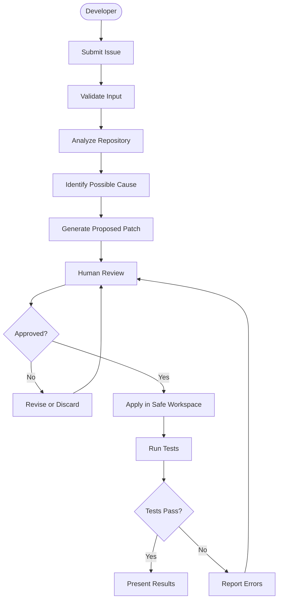

# Vidhata AI — Workflow Agent

**A developer workflow assistant that helps developers understand issues, explore code, and work toward safer fixes with human approval.**

Vidhata AI ka goal hai developer ke workflow ko simpler, more transparent, aur beginner-friendly banana. Hum ek aisa assistant build kar rahe hain jo issue submission se lekar proposed code changes aur testing tak ke workflow ko organize kar sake.

> **Project status:** Early-stage prototype. Some workflow stages described below are planned and are not implemented yet.

## ✨ Why Vidhata?

Developers often spend time understanding bugs, finding relevant files, investigating possible causes, and validating fixes.

Vidhata ka vision hai in steps ko ek structured workflow mein lana—while keeping the developer in control.

## 🚀 Current Features

- Issue description submit karne ke liye frontend form
- FastAPI backend ke saath frontend integration
- Basic issue input validation
- Initial frontend dashboard and file-explorer UI
- Git-based version control

## 🗺️ Workflow Roadmap



**Note:** This diagram represents the intended workflow. Repository analysis, AI-generated patches, approval controls, and automated test execution are roadmap items, not currently completed features.

## 🧰 Planned Technology Stack

- **Frontend:** Next.js, React, TypeScript
- **Backend:** Python, FastAPI
- **AI runtime:** Ollama with a suitable coding model (planned)
- **Version control:** Git and GitHub
- **Validation:** Automated tests and developer review

The final AI model and execution architecture will be evaluated during development.

## 🏁 Getting Started

### Prerequisites

Install the following before running the project:

- Node.js and npm
- Python 3.11 or a compatible version supported by the backend dependencies
- Git

### Project Structure

```text
vidhata-workflow-agent/
├── backend/
│   ├── main.py
│   ├── config.py
│   ├── requirements.txt
│   ├── requirements-dev.txt
│   └── tests/
└── frontend/
    ├── src/
    └── README.md
```

### Run the Backend

Open PowerShell in the project root:

```powershell
cd backend
python -m venv .venv
.\.venv\Scripts\Activate.ps1
pip install -r requirements.txt
uvicorn main:app --reload
```

Backend health check: `http://127.0.0.1:8000/health`

### Run the Frontend

Open a **second terminal** from the project root:

```powershell
cd frontend
npm install
npm run dev
```

Open `http://localhost:3000` in your browser.

## 🔐 Development Principles

- **Human in control:** Proposed changes should be reviewed before application.
- **Security first:** Never commit API keys, passwords, tokens, or `.env` files.
- **Transparency:** Clearly report what is implemented, proposed, tested, or incomplete.
- **Modular design:** Keep components replaceable and maintainable.
- **Developer ownership:** Code changes should remain reviewable and version-controlled.

## 🤝 Team Collaboration

Vidhata is being developed collaboratively by a four-member team.

We aim to use small tasks, clear ownership, Git branches, and pull requests to make contributions easier to review.

## 📌 Roadmap

- [x] Frontend and backend initial integration
- [x] Basic issue submission and validation
- [ ] Repository-aware code analysis
- [ ] AI-assisted explanation of possible causes
- [ ] Proposed patch generation
- [ ] Human approval workflow
- [ ] Safe patch application
- [ ] Automated test execution and result reporting

## 📄 License

No open-source license has been selected yet. Licensing will be decided before a public open-source release.

---

**Vidhata AI — Understand the issue. Review the change. Keep the developer in control.**
